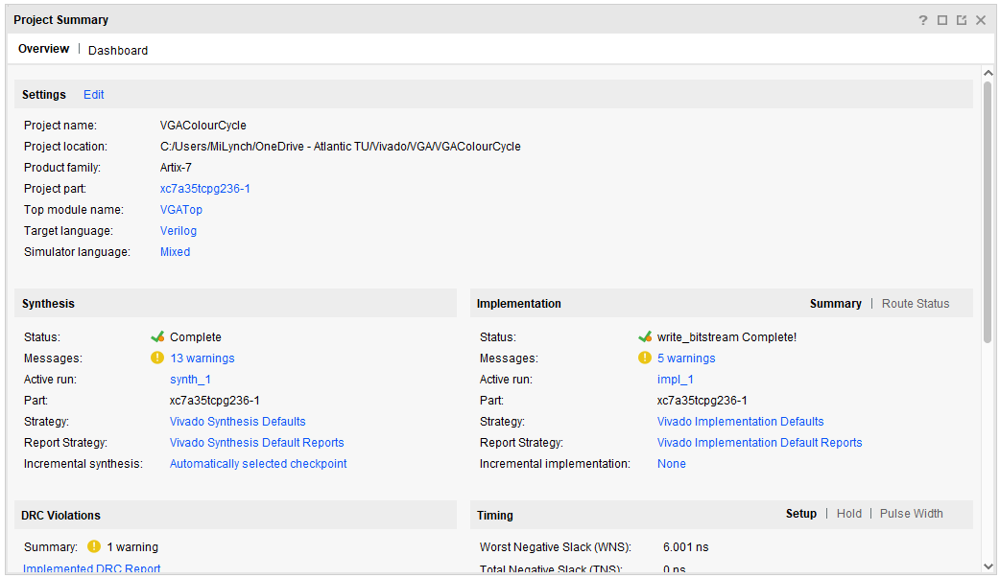
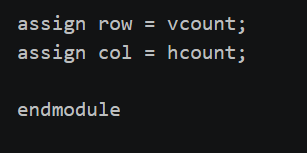
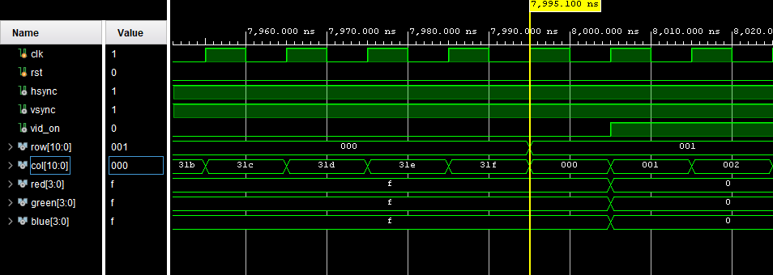
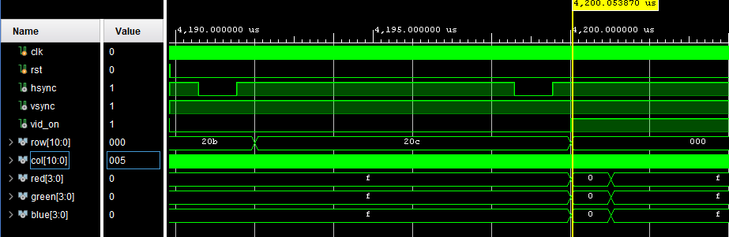
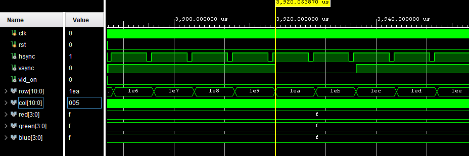

# **System on Chip Project**

<!-- Add picture of finished project -->

## Project Overview

System on Chip Design and Verification Project using the *Artix-7 FPGA* board.

An *FPGA board* is a Printed Circuit Board (PCB) built around a Field-Programmable Gate Array chip, which allows engineers to configure the hardware's digital logic after manufacturing using Hardware Description Languages (HDLs) such as Verilog.

This Markdown file documents my weekly progress throughout my third-year System on Chip Design and Verification Project.

The objective of my project was to modify the original VGA colour stripes template to create an animated image consisting of appearing horizontal and vertical lines using a Finite State Machine (FSM).

### Project Objectives

- Develop an understanding of Verilog syntax.
- Understand the differences between combinational and sequential logic.
- Understand VGA communication and display timing.
- Manipulate individual pixels using horizontal and vertical coordinates.
- Understand and interpret simulation timing diagrams.
- Implement a counter and a Finite State Machine.
- Generate an animated pattern on a VGA monitor using an FPGA.

---

### **12/10/2026**

**First upload of the template Stripes file onto the screen**

<kbd></kbd>

During the first week, I became familiar with the Vivado development environment and uploaded the provided VGA colour stripes template onto the FPGA board.

I began to understand the importance of file hierarchy and how different Verilog modules communicate with each other within a project.

<kbd>&nbsp;</kbd>

I inspected the code to understand Verilog syntax.

Verilog is a Hardware Description Language used to design, model and verify digital circuits such as microprocessors, counters, registers and flip-flops.

The VGA monitor displays an image with a resolution of 640 × 480, meaning that the visible image is 640 pixels wide and 480 pixels high.

The original template divides the screen into eight vertical stripes, each 80 pixels wide.

The code in the `VGAColourStripe.v` module is composed of both combinational and sequential logic.

- **Combinational logic:** Determines the colour of a pixel depending on its current position.
- **Sequential logic:** Stores the calculated RGB values in registers on the rising edge of the clock.

Each RGB colour channel consists of four bits, allowing 16 different intensity levels per channel and a total of 4096 possible colour combinations.

---

### **19/10/2026**

**Practising Verilog syntax and understanding VGA synchronisation**

<kbd></kbd>

To manipulate the width and height of the stripes, I experimented with changing the conditions within the `if` statements.

For example:

```verilog
if(row >= 11'd0 && row < 11'd100) begin
    red_next   = 4'h0;
    green_next = 4'h8;
    blue_next  = 4'h0;
end
```

This condition assigns a green colour to the first 100 visible rows of the display.

The `row` variable represents the vertical position of a pixel, while the `col` variable represents its horizontal position.

Within the visible display area:

- `row` ranges from 0 to 479.
- `col` ranges from 0 to 639.

By modifying these conditions, I was able to change the position, colour and dimensions of the displayed stripes.

#### Understanding VGASync.v

<kbd>&ensp;</kbd>

In `VGASync.v`, the code controls two counters:

- `hcount`: Horizontal counter, ranging from 0 to 799.
- `vcount`: Vertical counter, ranging from 0 to 524.

Although the visible resolution is 640 × 480, additional clock cycles and lines are required for synchronisation.

The standard VGA timing parameters are shown below:

| Parameter | Horizontal | Vertical |
|---|---:|---:|
| Visible display | 640 | 480 |
| Front porch | 16 | 10 |
| Sync pulse width | 96 | 2 |
| Back porch | 48 | 33 |
| Total | 800 | 525 |

The horizontal counter increments by one on every rising edge of the pixel clock.

Once the horizontal counter reaches its maximum value of 799, it resets to zero and increments the vertical counter by one.

Once the vertical counter reaches 524 and the horizontal line finishes, both counters return to zero and a new frame begins.

#### Horizontal and Vertical Synchronisation

`hsync` and `vsync` are active-low synchronisation signals used to communicate timing information to the VGA monitor.

<kbd>&ensp;</kbd>

- `hsync` synchronises the monitor with the next horizontal line.
- `vsync` synchronises the monitor with the next complete frame.

The signals are described as active-low because they are normally HIGH (logic 1) and become LOW (logic 0) during the synchronisation pulse.

The horizontal synchronisation pulse remains LOW for 96 pixel clock cycles, while the vertical synchronisation pulse remains LOW for two complete horizontal lines.

The `vid_on` signal determines whether the current pixel is within the visible display area.

```verilog
if(hcount < HDISP && vcount < VDISP)
    vid_on <= 1;
else
    vid_on <= 0;
```

When `vid_on` is HIGH, the current pixel belongs to the visible display. When it is LOW, the VGA system is within the blanking interval.

---

### **26/10/2026**

**Working with rows and columns**

<kbd></kbd>

During this week, I focused on understanding how the horizontal and vertical pixel coordinates could be used to generate different patterns on the screen.

The original template only used the `col` variable to generate vertical stripes.

By using the `row` variable instead, horizontal stripes can be generated.

Combining both variables allows specific rectangular areas of the display to be selected.

For example:

```verilog
if(row >= 11'd100 && row < 11'd200 &&
   col >= 11'd200 && col < 11'd400) begin
    red_next   = 4'hF;
    green_next = 4'h0;
    blue_next  = 4'h0;
end
```

This example generates a red rectangle that is 200 pixels wide and 100 pixels high.

Understanding the relationship between rows and columns was important for developing the horizontal and vertical lines required for my final project.

It also helped me understand how mathematical conditions can be used to generate images directly through hardware logic.

---

### **02/11/2026**

**Simulation and timing diagrams**

During this week, I investigated the behaviour of the VGA signals using simulation timing diagrams in Vivado.

<kbd></kbd>

The horizontal and vertical counters are initialised to zero.

On every rising edge of the 25 MHz pixel clock, the horizontal counter increments by one.

When the horizontal counter reaches `0x31F` (799 in decimal), the following rising edge resets it to zero and increments the vertical counter.

The period of the 25 MHz clock can be calculated using:

```
T = 1 / f

T = 1 / 25,000,000

T = 40 ns
```

Therefore, each pixel clock cycle has a duration of 40 ns.

The time required to complete one horizontal line is:

```
800 × 40 ns = 32 µs
```

The time required to complete one frame is:

```
800 × 525 × 40 ns = 16.8 ms
```

This produces a refresh rate of approximately 59.52 Hz.

<kbd></kbd>

The timing diagrams helped me understand the relationship between the clock, `vid_on`, horizontal counter and vertical counter.

I also developed a better understanding of how sequential logic operates on the rising edge of a clock.

Non-blocking assignments (`<=`) allow registers to be updated using the values calculated from the current clock cycle.

<kbd></kbd>

Simulation is an important part of digital hardware verification because it allows the behaviour of a design to be investigated before implementing it on the FPGA.

---

### **09/11/2026**

**Developing the animation and understanding counters**

<kbd></kbd>

The next stage of my project was to investigate how a static VGA image could be converted into an animated image.

The FPGA operates at a frequency that is too fast for individual clock cycles to be perceived by the human eye.

Therefore, a counter can be used to control the speed at which the displayed pattern changes.

Instead of changing the image on every clock cycle, the counter increments until it reaches a predefined value. Once this value is reached, the animation can progress to its next stage.

This allows the horizontal and vertical lines to appear at a visible speed without reducing the VGA pixel clock frequency.

I also investigated the purpose of the counter parameters provided in the original template:

```verilog
parameter COUNTER_WIDTH = 32,
parameter COUNT_FROM = 0,
parameter COUNT_TO = 32'b1 << 26,
parameter COUNT_RESET = 32'b1 << 27
```

The left shift operator (`<<`) shifts the binary value to the left.

For example:

```
1 << 26 = 2^26 = 67,108,864
1 << 27 = 2^27 = 134,217,728
```

These parameters can be used to define the counter width, starting value and timing thresholds for controlling an animation.

---

### **16/11/2026**

**Finite State Machine (FSM)**

A Finite State Machine is a digital circuit that can exist in a finite number of predefined states.

The machine transitions between these states depending on its current state and input conditions.

For my project, a state machine provides a method of controlling the sequence in which the horizontal and vertical lines appear on the VGA display.

Each state represents a different stage of the animation.

A Finite State Machine generally consists of three main components:

- **State register:** Stores the current state of the machine.
- **Next-state logic:** Determines which state the machine should transition to.
- **Output logic:** Determines the outputs associated with each state.

The state register uses sequential logic, while the next-state logic generally uses combinational logic.

A counter can be used to determine when the state machine should transition to the next state.

By combining the state machine with the pixel coordinates, different patterns can be displayed depending on the current state.

This allows the animation to progress through multiple stages rather than displaying a single static image.

<!-- Add state machine diagram -->

<!-- Add final state machine Verilog code -->

<!-- Describe each state and its transition conditions -->


## **Conclusion**

Throughout this project, I developed a better understanding of digital hardware design using Verilog and FPGA technology.

Starting with a basic VGA colour stripes template, I investigated how pixel coordinates, RGB values and synchronisation signals work together to generate an image on a monitor.

I also developed my understanding of combinational and sequential logic, counters, registers and Finite State Machines.

The use of simulation timing diagrams helped me understand how different signals interact with each other over time and how simulation can be used to verify digital circuits.

This project demonstrated how relatively simple digital logic can be combined to create more complex hardware behaviour, such as animated images on a VGA display.
