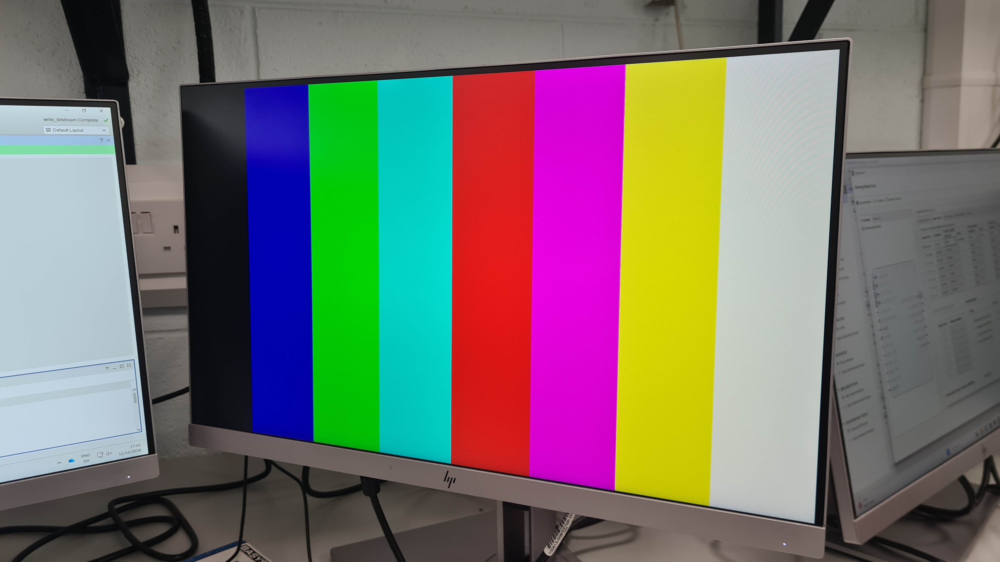
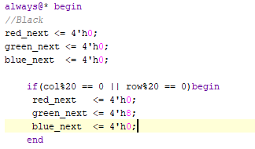

# **System on Chip Project**
//Add pic of finished project

System on Chip Design Project using the *Artix-7 FPGA* board.  
An *FPGA board* is a Printed Circuit Board build around a Field-Programmable Gate Array chip, which allows engineers to configure the hardware's logic after manufacturing using Hardware Description Languages such as Verilog.

This _Markdown_ file shows weekly progresses for my 3rd year System on Chip Design and Verification Project.  
I modified the template file to create a moving image showing appearing horizontal and vertical lines using a state machine.  

---  

### **12/10/2026**
**First upload of the template Stripes file on the screen**  
  
Understanding the importance of file Hierarchy.  

 &nbsp;   
Inspecting the code to understand Verilog Syntax.  
Verilog is a Hardware Description Language, used to design and verify digital circuits like microprocessors, flip-flops, and switches.  

The code in the `VGAColourStripe.v` file 

---  
### **19/10/2026**  
**Practicing Verilog language**  
  
Playing around with the width of the colour stripes  
The VGA 640x480 displays images that are 640 pixels wide and 480 pxs in hight.  

---  
### **26/10/2026**
**Working around the row and the columns**  
  
---  
### **02/11/2026**
**Timing diagram**  
  
The timing diagram helped me understand the relationship between the **clock** counter, **hsync**, **vsync** and the rows and columns count.  

---  
### **09/11/2026**
  
 
---  
### **16/11/2026**  
**state machine**  

