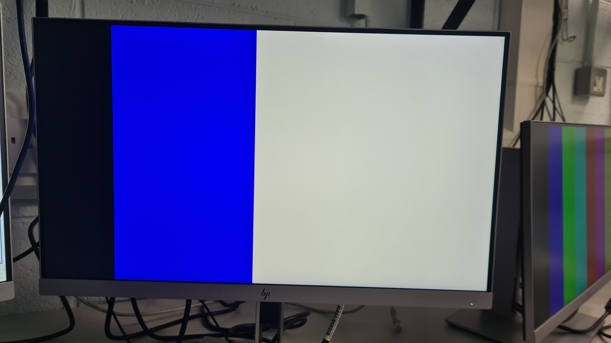
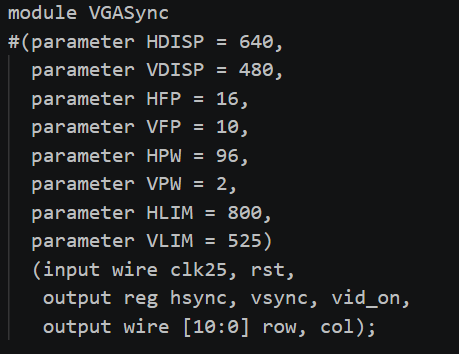
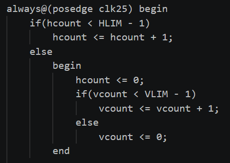
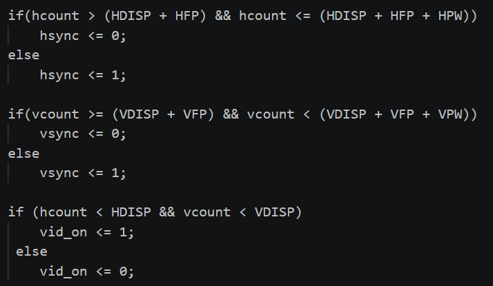

# **System on Chip Project**
//Add pic of finished project

System on Chip Design Project using the *Artix-7 FPGA* board.  
An *FPGA board* is a Printed Circuit Board build around a Field-Programmable Gate Array chip, which allows engineers to configure the hardware's logic after manufacturing using Hardware Description Languages such as Verilog.

This _Markdown_ file shows weekly progresses for my 3rd year System on Chip Design and Verification Project.  
I modified the template file to create a moving image showing appearing horizontal and vertical lines using a state machine.  

---  

### **12/10/2026**
**First upload of the template Stripes file on the screen**  
<kbd></kbd>  
Understanding the importance of file Hierarchy.  

<kbd>&nbsp;</kbd>  
Inspecting the code to understand Verilog Syntax.  
Verilog is a Hardware Description Language, used to design and verify digital circuits like microprocessors, flip-flops, and switches.  

The VGA 640x480 displays images that are 640 pixels wide and 480 pxs in hight.  

The code in the `VGAColourStripe.v` module is composed of both Combinational and Sequential Logic.  

---  
### **19/10/2026**  
**Practicing Verilog language**  
<kbd></kbd>  
To manipulate the with of the stripes I simply changed the value within the statement:  
_if(row >= 11'd0 && row = 11'd100) begin  
&emsp;red_next   <= 4'h0;  
&emsp;green_next <= 4'h8;  
&emsp;blue_next  <= 4'h0;  
end_  
The variable _row_ can have a value between 0 and 479, while _col_ can have a value between 0 and 639.  
  
<kbd>&ensp;</kbd>  
In `VGASync.v` we find the code that controls the variable _hcount_ which it can have a value between 0 and 799 (600 visible pxs + 15 front porch pxs + 47 back porch pxs + 96 sync pulses), and _vcount_ that goes from 0 to 524 (480 visible pxs + 10 front porch pxs + 33 back porch pxs + 2 sync pulses;  
  
The image above shows the incrementing of hcount (horizontal count) by one until it has reached the end of the row, and when that happens increments vcount (vertical count) by one until it reaches the bottom of the column.  
  
_hsync_ and _vsync_ are active low Synchronization Pulses...  
<kbd> &ensp; </kbd>

---  
### **26/10/2026**
**Working around the row and the columns**  
<kbd></kbd>  

---  
### **02/11/2026**
**Timing diagram**  
Every rising edge of the clock other values are incremented, starting with rows which gets initialized with a value of 0, after the first rising edge the col goes from 0 to one and when it reaches a value of 0x31F (799 decimal) the row gets incremented.
of the 25Mhz clock with a period of 10ns between rising edges.  

<kbd></kbd>  
The timing diagram helped me understand the relationship between the *clock* counter, *vid_on*, *rows* and *columns* count.  
  

<kbd></kbd>
  
<kbd></kbd>

---  
### **09/11/2026**
<kbd></kbd>  
 
---  
### **16/11/2026**  
**state machine**  

