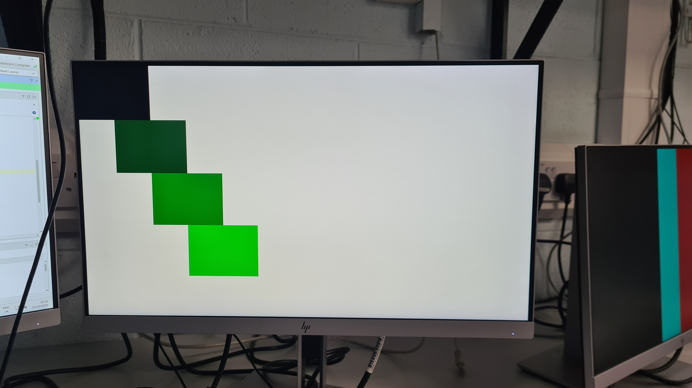

# **System on Chip Project**
//Add pic of finished project

System on Chip Design Project using the Artix-7 FPGA board.
This file will show weekly progresses.

### **12/10/2026**
First upload of the template file on the screen

### **19/10/2026**
Trying to get my head around the rows and the colums

